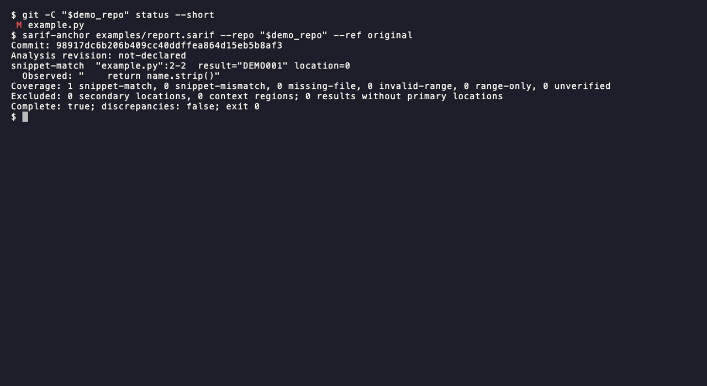

# sarif-anchor

Catch stale source citations before reviewing a SARIF report.

[](https://github.com/itzjk/sarif-anchor/actions/workflows/ci.yml)
[](LICENSE)



## Quick start

Requires Python 3.9+, Git 2.45+, and [pipx](https://pipx.pypa.io/stable/installation/).

```sh
pipx install git+https://github.com/itzjk/sarif-anchor.git
```

```sh
sarif-anchor report.sarif --repo . --ref HEAD
```

## Features

- Pin every check to a resolved commit, even with staged or uncommitted edits.
- See the observed text and exact range for each primary location.
- Keep mismatches visible alongside unsupported or missing evidence.
- Feed stable JSON and documented exit codes into CI.
- Read local Git objects without checking out files or running the project.

## Why

A valid SARIF document can quote code from a different revision than the one under review. Workflows such as [Cloudflare's security audit skill](https://github.com/cloudflare/security-audit-skill) produce structured findings and require independent verification; the [SARIF SDK's AI guidance](https://github.com/microsoft/sarif-sdk/blob/main/docs/ai/generating-sarif.md) separates source coordinates from quoted evidence. sarif-anchor tests the narrower, deterministic question: does that citation match this commit?

The [SDK](https://github.com/microsoft/sarif-sdk) validates and enriches SARIF, while [Adjudge](https://github.com/takoneko8/adjudge) triages findings. The [comparison notes](docs/comparison.md) record the attempted two-commit demo and the boundary between these tools.

## How it works

The CLI resolves `--ref` to a commit, walks its trees, and reads regular blobs. It checks each result's primary locations against the declared line range, then compares `region.snippet.text` when present. Only CRLF becomes LF: spaces, tabs, Unicode, and all other content stay significant. The final line's terminator is outside the region. A mismatch stays at its declared coordinates, without searching nearby lines. The output names the commit used and separately lists any revision declared by the report.

## Usage

| Option | Purpose |
| --- | --- |
| `report.sarif` | UTF-8 SARIF 2.1.0 report |
| `--repo PATH` | Local repository, including a bare repository |
| `--ref REVISION` | Commit, tag, or other local Git revision |
| `--json` | JSON contract version 1, with full observed evidence |
| `--max-blob-bytes N` | Maximum bytes per source blob, default 4 MiB |
| `--max-report-bytes N` | Maximum report size, default 16 MiB |
| `--version` | Show the installed version |

| Exit | Meaning |
| --- | --- |
| `0` | Nonempty report; every primary citation has a matching snippet, with no exclusions |
| `1` | Discrepancy, including a missing file, invalid range, or declared revision difference |
| `2` | Incomplete check, range-only evidence, or empty report, with no discrepancy |
| `3` | Invalid input, unresolved revision, or failure to initialize Git access |

When discrepancies and incomplete coverage coexist, exit `1` preserves both in JSON. `complete` describes coverage, not whether citations matched. See [the contract](docs/contract.md) for statuses, limits, exclusions, and revision semantics.

## FAQ

**Does a match confirm a vulnerability?** No. It confirms the quoted text at those coordinates. Reviewing the finding's interpretation remains separate work.

**Does it touch my checkout or report?** No. HEAD, index, worktree, and input report stay unchanged. Checkout filters, textconv, fixes, and project code never run.

**What if a report has no snippets?** Existing ranges receive `range-only` and exit `2`. A range alone cannot establish code equivalence.

**Can it fetch missing objects?** No. Supply the objects locally before running it. Network protocols and lazy fetching are disabled during checks.

## Limitations

- Supports direct repository-relative URIs and whole-line primary regions only.
- Columns, offsets, indirect references, unresolved URI bases, custom newline sequences, binary data, non-UTF-8 encodings, and byte order marks remain unverified.
- Symlinks and submodules receive explicit diagnostics; their targets are never followed.
- Secondary locations and context regions are excluded, counted, and prevent complete coverage.
- This is a citation check, not a complete SARIF schema validator. No declared revision means the analyzed commit is unknown.

## Contributing

Run `python3 -m unittest discover -s tests -v`; [development notes](docs/development.md) cover clean installs, the synthetic demo, and official validation.

## License

[MIT](LICENSE).
